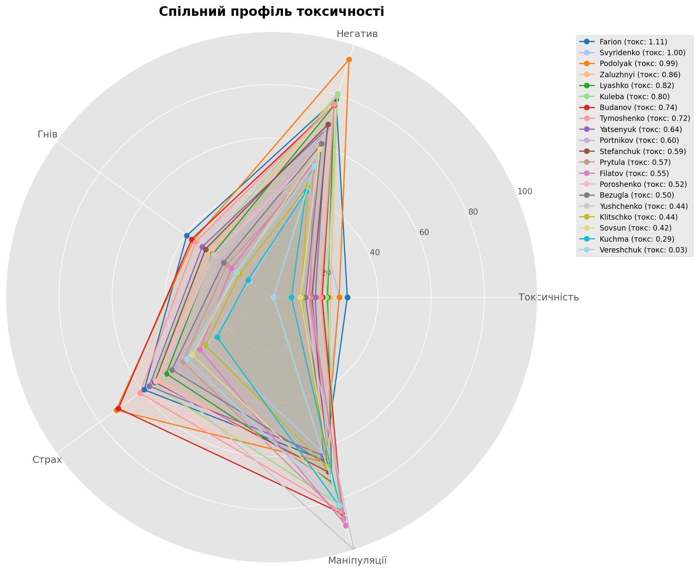

# Аналіз токсичності, емоцій і маніпуляцій у політичних текстах

Програма на Python порівнює тексти 20 публічних авторів українською мовою
за токсичністю, емоційністю та маніпулятивними тактиками.



## Що робить програма
- Читає звіти сервісу TextAttributor (.txt) і витягує показники регулярними виразами.
- Збирає дані в pandas DataFrame: токсичність, 10 емоцій, маніпулятивні тактики.
- Рахує емоційну інтенсивність і співвідношення позитивної та негативної лексики.
- Створює 8 типів графіків (PNG) і таблицю Excel.

## Структура репозиторію
- `toxicity_analysis.py` — код програми
- `data/sample/` — приклад вхідного файлу
- `results/` — приклад результатів
- `requirements.txt` — потрібні бібліотеки

## Результат
Індекс токсичності між 20 авторами коливається від 0,03 до 1,11
(середнє близько 0,63). Тексти емоційно насичені, а негатив, страх і гнів
лишаються помітною частиною профілю.

## Як запустити
```
pip install -r requirements.txt
python toxicity_analysis.py
```

## Примітка щодо даних
Повні тексти авторів не публікуються. Прізвища замінено на Author A, B, C.
Це демонстрація методу, а не оцінка осіб.
